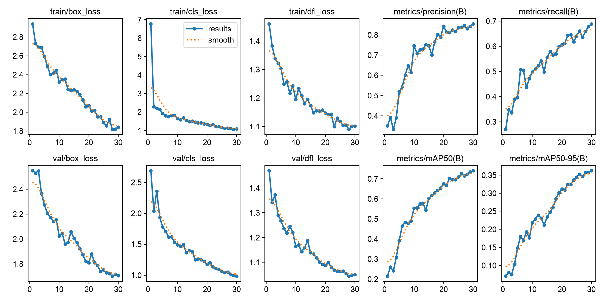
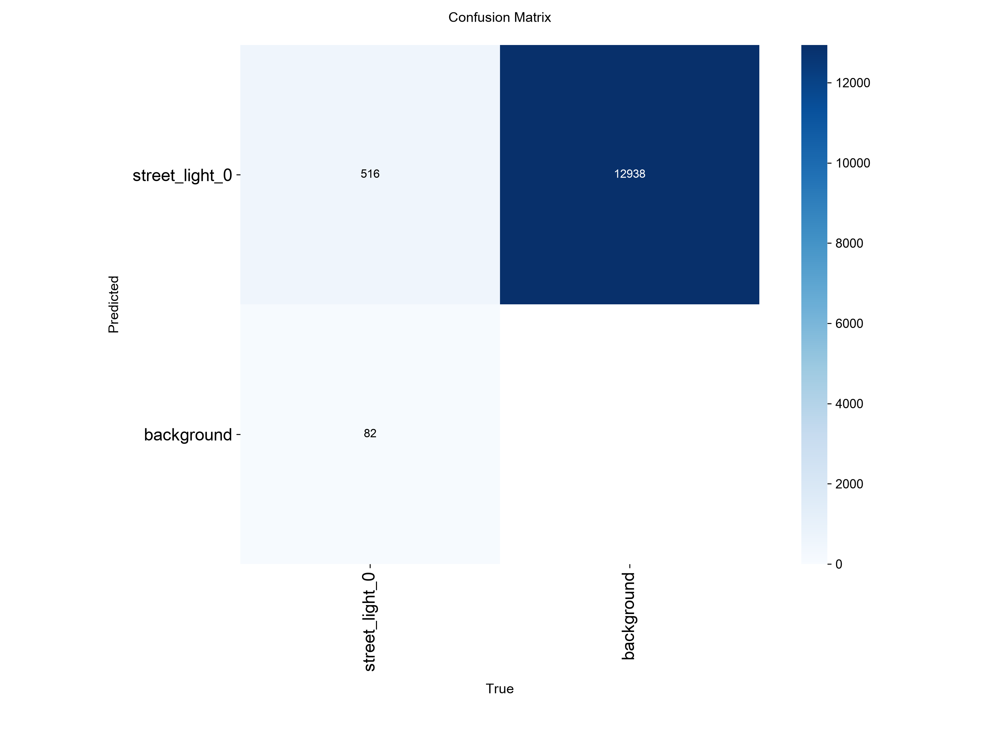
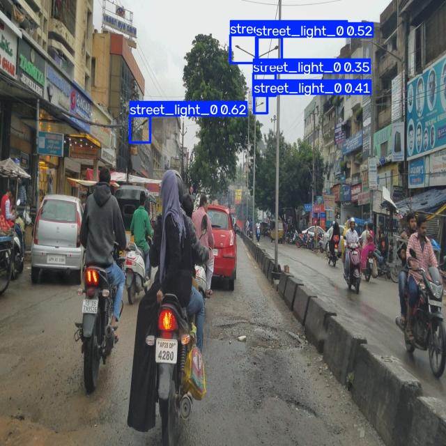
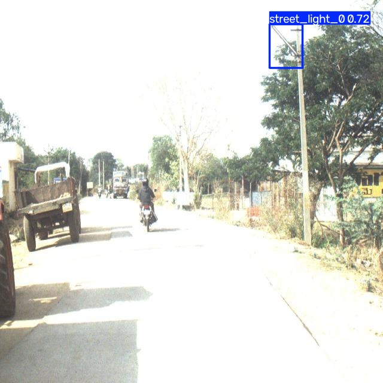
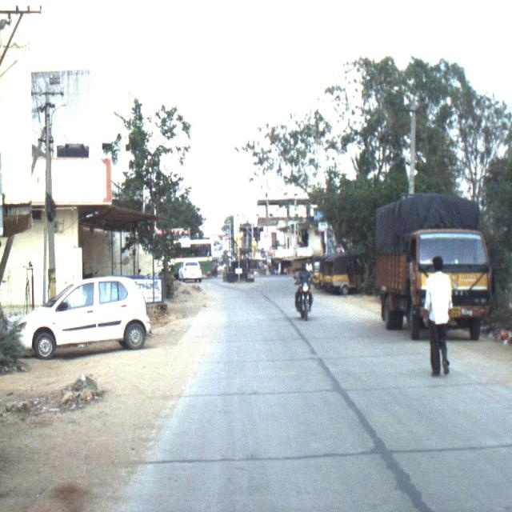

# LuzSegura — Detecção Inteligente de Iluminação Pública

**FIAP | Global Solution 2026.2**  
**Disciplina:** Applied Computer Vision  
**Curso:** Engenharia de Software — 4º ano
**Grupo:** Aluno: Guilherme Dal Posolo Matheus RM: 98694 //
Aluno: Guilherme Faustino Vargas RM: 98278 //
Aluno: João Lucas Yudi RM: 98458 //
Aluno: Lucas Laia Manentti RM: 97709 //
Aluno: Ryan Perez Pacheco RM: 98782 //


## 1. Sobre o projeto

O LuzSegura é uma solução CitizenTech desenvolvida para apoiar
o monitoramento de infraestrutura de iluminação pública.

O módulo de visão computacional utiliza o modelo YOLO11n,
treinado de forma personalizada para identificar luminárias
em imagens e vídeos.

A solução permite identificar possíveis luminárias,
visualizar as detecções e registrar os resultados para
integração com outros componentes do projeto.

## 2. Objetivo

Desenvolver um sistema de visão computacional capaz de
identificar luminárias de iluminação pública por meio da
detecção de objetos, usando uma arquitetura YOLO11n
treinada com um conjunto de imagens anotadas.

## 3. Tecnologias usadas no projeto

- Python
- Ultralytics YOLO11n
- OpenCV
- PyTorch
- Apple Metal Performance Shaders (MPS)
- CSV e JSON
- Git e GitHub

## 4. Treinamento do modelo

Foi utilizada a arquitetura YOLO11n com pesos pré-treinados,
seguida de treinamento personalizado com imagens de luminárias.

Configurações do treinamento:

- Modelo inicial: YOLO11n
- Épocas máximas: 30
- Resolução: 512 pixels
- Batch size: 4
- Dispositivo: Apple Silicon MPS
- Early stopping: patience de 10 épocas

Comando utilizado:

```bash
yolo detect train model=yolo11n.pt data=dataset/data.yaml epochs=30 imgsz=512 batch=4 device=mps workers=0 patience=10 project=resultados name=treinamento_luzsegura exist_ok=True
```

## 5. Avaliação do modelo

O modelo foi avaliado utilizando 124 imagens de teste,
contendo 346 instâncias anotadas.

| Métrica | Resultado |
|---|---:|
| Precision | 87,3% |
| Recall | 66,8% |
| mAP50 | 71,7% |
| mAP50-95 | 34,9% |

Os resultados demonstram capacidade de reconhecer luminárias
em imagens não utilizadas para treinamento.

Mas, ainda existem limitações na identificação
de objetos pequenos, distantes ou parcialmente encobertos.

## 6. Funcionamento do detector

O sistema utiliza a webcam para capturar imagens em tempo real.

Cada quadro é processado pelo modelo personalizado,
que identifica possíveis luminárias e desenha caixas
com os respectivos níveis de confiança.

O detector apresenta:

- Identificação visual das luminárias.
- Contagem das detecções por quadro.
- Confiança das previsões.
- Painel informativo LuzSegura.
- Histórico de registros em CSV.
- Exportação da última leitura em JSON.

A exportação JSON permite que outros componentes
do projeto consultem os resultados gerados.

## 7. Estrutura do projeto


GS-LuzSegura-CV/
├── dataset/
│   └── data.yaml
├── modelos/
│   └── luzsegura_yolo11n.pt
├── detector.py
├── main.py
├── requirements.txt
├── .gitignore
└── README.md


As imagens do dataset e os arquivos temporários de
treinamento não são incluídos no repositório.

## 8. Como executar o projeto

### Preparar o ambiente

É recomendado utilizar Python 3.11.

```bash
python3.11 -m venv .venv
source .venv/bin/activate
python -m pip install -r requirements.txt
```

### Executar o detector

Na pasta principal do projeto:

```bash
python detector.py
```

O programa tentará acessar a webcam principal do computador.

Para encerrar, pressione `Q` na janela do vídeo.

### Preparar o dataset para novo treinamento

Baixe o dataset indicado na seção 4, extraia e coloque
as pastas `train`, `valid` e `test` dentro de
`dados_originais/`.

Depois execute:

```bash
python main.py
```

Esse comando organiza as imagens e suas anotações
e gera o arquivo `dataset/data.yaml`.

## 9. Limitações

O modelo identifica possíveis luminárias, mas não determina
se estão acesas, apagadas ou apresentando defeitos elétricos.

As previsões podem incluir falsos positivos e falsos negativos.

O registro da quantidade de detecções não representa uma
contagem definitiva da infraestrutura de iluminação pública.

## 10. Considerações finais

O módulo de visão computacional demonstrou
a viabilidade técnica de utilizar detecção de objetos
para identificar luminárias de iluminação pública.

Como evolução, o sistema poderá ser integrado a sensores
de luminosidade, plataformas de monitoramento e automações
de análise de ocorrências.


---

## 11. Evidências do treinamento e da detecção

Esta seção apresenta os resultados obtidos durante
o treinamento e a avaliação do modelo YOLO11n
personalizado para o projeto LuzSegura.

### - Evolução do treinamento

O gráfico abaixo apresenta a evolução das métricas
e das perdas durante o treinamento do modelo.



### - Matriz de confusão

A matriz de confusão auxilia na análise dos
acertos e erros do modelo durante a avaliação.



### - Resultados da detecção

**Exemplo 1 — Detecção correta**

Exemplo de uma luminária identificada pelo
modelo de visão computacional.



**Exemplo 2 — Detecção com dificuldade**

Exemplo de situação em que características
da imagem dificultam a identificação da luminária.



**Exemplo 3 — Limitação do modelo**

Exemplo de erro ou limitação observado durante
os testes, evidenciando oportunidades de melhoria.



### - Métricas no conjunto de teste

O modelo foi avaliado utilizando 124 imagens de
teste contendo 346 luminárias anotadas.

| Métrica | Resultado 
| Precision: 87,3% 
| Recall: 66,8% 
| mAP50: 71,7% 
| mAP50-95:  34,9% 

Os resultados indicam que o modelo aprendeu
características visuais das luminárias.

Entretanto, ainda apresenta limitações na
detecção de objetos pequenos, distantes
ou parcialmente encobertos.

```
